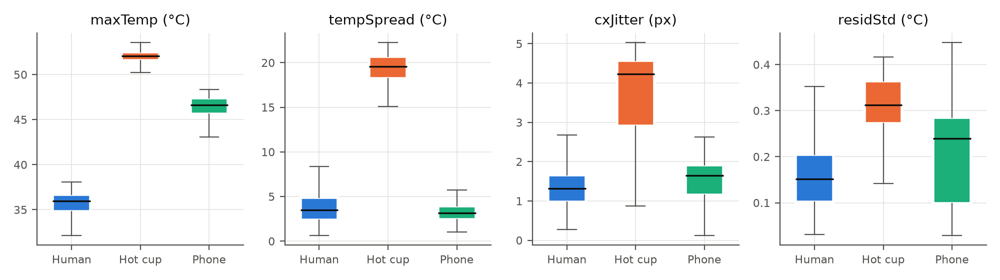
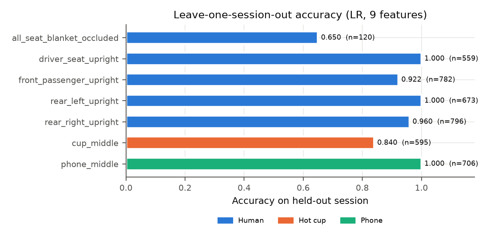
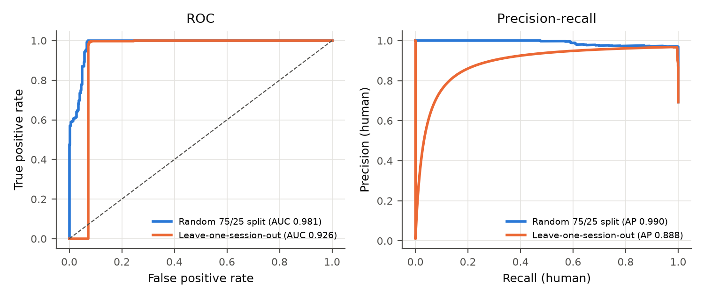
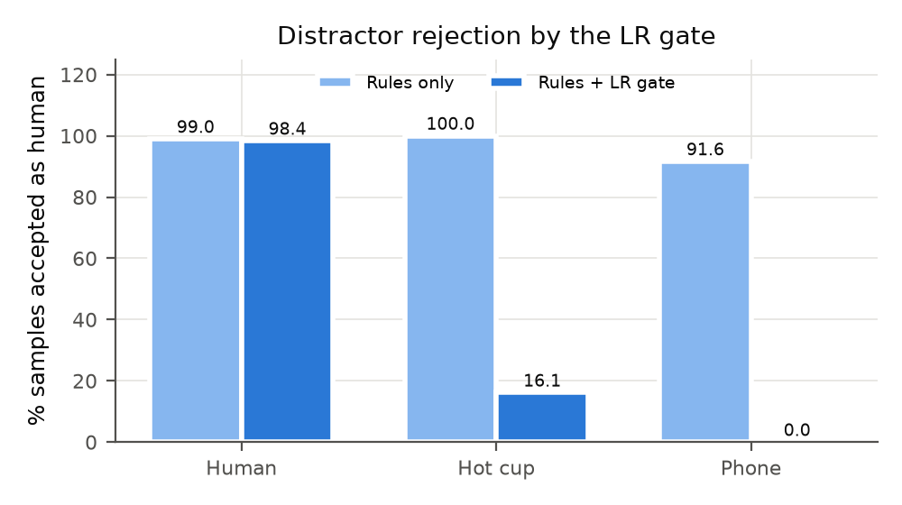
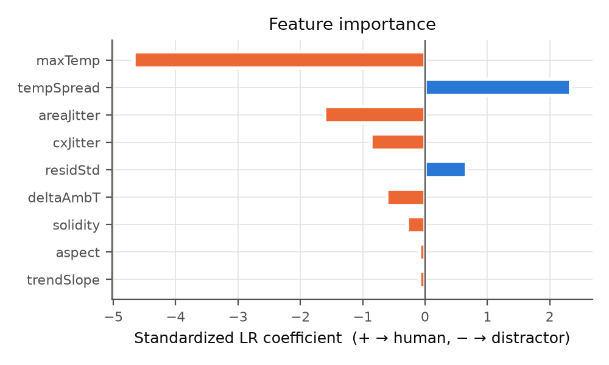
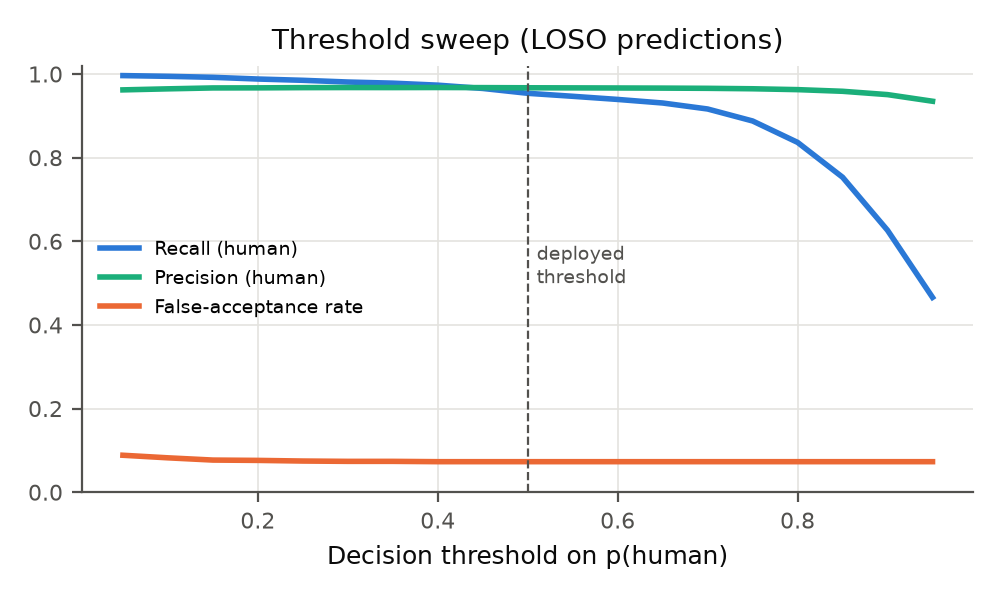

# RESULT.md: Detailed Experimental Results

> All numbers come from `tools/eval_extra.py`, which reads the data in `data/raw/` and the deployed model in `data/models/lr_model.json`. The full output is in `docs/results/metrics.json` and the figures are in `docs/figures/`. Generated on 2026-10-10 with seed 42 and scikit-learn 1.x.
>
> To reproduce:
> ```bash
> pip install numpy pandas scikit-learn matplotlib
> python tools/train_classifier.py     # deployed model + §2
> python tools/eval_extra.py           # everything else
> ```

---

## 0. Summary of findings

| # | Finding | Evidence |
|---|---|---|
| F1 | The static rule cascade cannot reject thermal distractors. It accepts **100%** of hot-cup samples and **91.6%** of phone samples as human. | §4, Fig. `fig_rules_vs_lr.png` |
| F2 | Adding the LR gate cuts acceptance to **16.1% (cup)** and **0% (phone)**, while human acceptance falls only from 99.0% to 98.4%. | §4 |
| F3 | On a random 75/25 split the LR gate scores **Acc 0.977 [95% CI 0.968–0.985]** and **AUC 0.981**. | §2 |
| F4 | Under **leave-one-session-out (LOSO)**, the honest estimate, accuracy drops to **0.946 [0.939–0.952]**. The random split is optimistic by about 3 points. | §3 |
| F5 | **Blanket occlusion** is the hardest case: LOSO accuracy 0.65, with 39% of seconds in alert at the system level. | §3, §7 |
| F6 | **Important negative result:** under LOSO a 1-feature LR on `maxTemp` (Acc **0.978**) beats the 9-feature LR (0.946). In the current data the temporal features add **no** out-of-session benefit. | §5, §6 |
| F7 | The higher-capacity models (DT, RF, MLP) look near-perfect on the random split (0.98–0.997) but **collapse under LOSO** (0.74–0.90). They memorise sessions, which supports choosing a low-capacity LR. | §5 |
| F8 | The 96 "hot-cup" samples that pass the gate are about 35 °C blobs with a small spread. These are almost certainly the **operator's hand or arm, not the cup**, so they are label noise and the true cup FAR is probably below 16%. | §4.3 |
| F9 | At the system level (1 s windows + 5/7 debounce), the upright-human sessions reach **85–96% of seconds in alert**, with the first alert after **4–14 s**. The phone gives 0 false alerts. The cup session is in alert 18.7% of the time, which is the same label-noise effect as F8. | §7 |

---

## 1. Dataset

### 1.1 Sessions
Labels are assigned per session, from the folder name. The two `all_seat_blanket_occluded*` files are merged into one session. One file has a single row and was recorded on 2026-08-19; the `_2` file lasts 68.8 s.

| Session | Class | Rows | Duration (s) | 1-s windows | Date |
|---|---|---|---|---|---|
| driver_seat_upright | human | 559 | 85.2 | 75 | 2026-08-19 |
| front_passenger_upright | human | 782 | 98.4 | 94 | 2026-08-19 |
| rear_left_upright | human | 673 | 120.6 | 93 | 2026-08-19 |
| rear_right_upright | human | 796 | 156.0 | 128 | 2026-08-19 |
| all_seat_blanket_occluded | human | 120 | 68.8 (+1 row) | 31 | 2026-08-19/20 |
| cup_middle | hot cup | 595 | 90.4 | 91 | 2026-09-01 |
| phone_middle | phone | 706 | 71.9 | 69 | 2026-09-03 |
| **Total** | | **4,231** (2,930 + / 1,301 −) | **≈ 11.5 min** | 581 | |

- Filtering keeps rows with `sampleCount ≥ 5` and no NaN/Inf, taking 4,235 rows to 4,231. Rows corrupted by USB-CDC byte drops are skipped by the parser.
- The positive-to-negative ratio is 2.25 : 1. Training compensates with `class_weight="balanced"`.
- One row is one tracked blob at one long-term sample. Rows inside the same second share the same long-term features (trend, jitter), so they are **not independent**.

### 1.2 Blob type at logging time (after the firmware's own gate)
| Class | REJECTED (0) | LOW_SUSPECT (1) | CANDIDATE (3) | PERSON (4) |
|---|---|---|---|---|
| human | 581 | 30 | 666 | 1,653 |
| hot cup | 28 | 0 | 20 | 547 |
| phone | 198 | 59 | 161 | 288 |

GRAY_ZONE (2) never appears in the logs because it always resolves to CANDIDATE or REJECTED within the same frame. This column reflects whatever LR weights were flashed at collection time, so it is **not** used as a baseline.

### 1.3 Feature statistics per class (mean ± std, median in brackets)
| Feature | Human | Hot cup | Phone |
|---|---|---|---|
| maxTemp (°C) | 35.7 ± 1.3 [35.96] | 49.5 ± 6.2 [52.08] | 46.4 ± 1.2 [46.62] |
| tempSpread (°C) | 3.7 ± 1.6 [3.49] | 17.0 ± 6.6 [19.58] | 3.2 ± 1.0 [3.18] |
| deltaAmbT (°C) | −2.4 ± 1.1 [−2.55] | 1.8 ± 2.0 [2.07] | 3.3 ± 1.0 [3.38] |
| residStd (°C) | 0.18 ± 0.13 [0.152] | 0.30 ± 0.09 [0.312] | 0.20 ± 0.10 [0.239] |
| cxJitter (px) | 1.39 ± 0.62 [1.31] | 3.59 ± 1.27 [4.23] | 1.47 ± 0.54 [1.65] |
| areaJitter (px) | 55.9 ± 51.5 [42.9] | 40.6 ± 22.9 [32.9] | 246 ± 412 [32.2] |
| trendSlope (°C/min) | 2.10 ± 3.00 [1.71] | 3.93 ± 2.19 [3.16] | 2.03 ± 3.15 [1.60] |
| solidity | 0.70 ± 0.17 [0.72] | 0.80 ± 0.08 [0.81] | 0.78 ± 0.15 [0.82] |
| aspect | 0.87 ± 0.33 [0.80] | 0.89 ± 0.16 [0.88] | 1.04 ± 0.56 [1.00] |
| pixelCount | 204 ± 312 [70] | 130 ± 48 [131] | 102 ± 125 [47] |

**Interpretation** (Fig. `fig_feature_dist.png`):
- **maxTemp** separates the classes almost perfectly. Humans sit in a narrow 32–38 °C skin band. The cup is above 50 °C and the phone around 46 °C, a phone that was presumably charging or busy.
- **tempSpread** is what tells cup from phone. A hot liquid with a cooler rim or body gives a spread of about 20 °C, while the phone's surface is nearly uniform at about 3 °C. Humans also show about 3.5 °C, from face vs clothing.
- **cxJitter** is high for the cup (4.2 px). The likely reason is that the operator moved the cup or the steam plume shifted the centroid.
- **residStd**, the breathing / micro-motion proxy, is *lower* for humans (0.15 °C) than for distractors. Breathing at 80×62 and roughly 1 Hz sampling is drowned out by other variation, so this feature does not behave as a liveness cue in the current data.
- **trendSlope** for the cup is *positive* (+3.2 °C/min), not the cooling we expected. Each session is short (90 s), and the blob probably kept growing or warming as it settled. Longer recordings are needed.
- **deltaAmbT** is negative for humans because the reference is the MI48 **die temperature** (about 38 °C, self-heated), not the cabin air.



---

## 2. Main result: stratified random split (75/25, seed 42)

This is the same protocol as `train_classifier.py` and it reproduces the deployed weights exactly.

| Metric | Value | 95% bootstrap CI |
|---|---|---|
| Accuracy | **0.9773** | 0.968 – 0.985 |
| F1 (human) | 0.9839 | 0.977 – 0.990 |
| Precision (human) | 0.9695 | |
| Recall / sensitivity (human) | 0.9986 | |
| Specificity | 0.9292 | |
| False-acceptance rate (FAR) | 0.0708 | |
| ROC-AUC | **0.9805** | |
| Average precision | 0.9895 | |
| n test | 1,058 (733 + / 325 −) | |

Confusion matrix (rows = truth, columns = prediction):

| | pred. distractor | pred. human |
|---|---|---|
| **distractor** | 302 | 23 |
| **human** | 1 | 732 |

Test-set acceptance per class: human 99.9%, hot cup 17.0%, phone 0.0%.

**5-fold stratified CV**: AUC 0.980, accuracy 0.973. This is consistent with the single split.

> ⚠️ A random row split puts rows from the same second and the same session into both train and test. Since those rows share their long-term features, the split leaks information. Treat these numbers as an **upper bound**.

---

## 3. Leave-one-session-out (LOSO): the recommended headline number

For each of the 7 sessions, the model is trained on the other 6 and tested on the held-out one. Predictions are pooled across folds.

| Metric | LOSO | Random split | Δ |
|---|---|---|---|
| Accuracy | **0.9456** [0.939–0.952] | 0.9773 | −0.032 |
| F1 (human) | 0.9605 | 0.9839 | −0.023 |
| Precision | 0.9671 | 0.9695 | |
| Recall | 0.9539 | 0.9986 | −0.045 |
| Specificity | 0.9270 | 0.9292 | |
| ROC-AUC (pooled) | 0.9263 | 0.9805 | |
| Average precision | 0.888 | 0.990 | |

Confusion matrix: [[TN 1206, FP 95], [FN 135, TP 2795]].

### Per session

| Held-out session | Class | n | Accuracy | Mean p(human) |
|---|---|---|---|---|
| driver_seat_upright | human | 559 | **1.000** | 0.932 |
| rear_left_upright | human | 673 | **1.000** | 0.975 |
| rear_right_upright | human | 796 | 0.960 | 0.848 |
| front_passenger_upright | human | 782 | 0.922 | 0.838 |
| all_seat_blanket_occluded | human | 120 | **0.650** | 0.660 |
| cup_middle (model trained on phone only) | cup | 595 | 0.840 | 0.160 |
| phone_middle (model trained on cup only) | phone | 706 | **1.000** | 0.012 |

**Interpretation:**
- **Seat position.** The model generalises across the four seats, all at ≥ 0.92. The front passenger seat is the weakest, perhaps because of viewing angle or partial occlusion by the dashboard.
- **Blanket occlusion.** This is the main failure mode (0.65). A blanket reduces the visible maxTemp and breaks up the blob. Since it is also the case CPD cares about most (a sleeping child under a blanket), the paper must state it explicitly.
- **Unseen distractor class.** A model that never saw a cup still rejects 84% of cup samples, and a model that never saw a phone rejects 100% of phone samples. The decision rule ("hotter than skin = not human") transfers between distractor types.
- **Pooled AUC (0.926) is lower than per-fold accuracy suggests.** The cause is that the 95 cup-session FPs get p ≈ 1, higher than many true humans, so the ROC curve starts flat (see `fig_roc_pr.png`). §4.3 shows these are mislabelled human-like blobs.




---

## 4. Rules only vs rules + LR gate

The rule cascade from `classify()` is re-applied to the logged features: `maxTemp ≤ 58 °C`, `pixelCount ≥ 15`, `0.35 ≤ aspect ≤ 2.8`. The gray-zone variance test cannot be recomputed from the CSV, so it is assumed to pass. The rules-only row is therefore an **upper bound on rule recall** and a **lower bound on rule FAR**.

### 4.1 Overall
| Method | Acc | Precision | Recall | F1 | Specificity | FAR |
|---|---|---|---|---|---|---|
| Rules only | 0.699 | 0.700 | 0.990 | 0.820 | **0.045** | **0.955** |
| Rules + LR (deployed weights, in-sample) | 0.966 | 0.968 | 0.984 | 0.976 | 0.926 | 0.074 |
| Rules + LR (LOSO, out-of-sample) | 0.939 | 0.967 | 0.944 | 0.955 | 0.927 | 0.073 |

### 4.2 Acceptance rate per class (% of samples accepted as human)
| Class | Rules only | Rules + LR (deployed) | Rules + LR (LOSO) |
|---|---|---|---|
| Human | 99.0% | 98.4% | 94.4% |
| Hot cup | **100.0%** | **16.1%** | 16.0% |
| Phone | **91.6%** | **0.0%** | 0.0% |

Why the rules failed:
- **Too hot (> 58 °C)** rejected 0 cup samples. The cup peaked at about 53 °C, below the threshold. The constant was set for boiling water, not for a drink that has been standing.
- **Too small (< 15 px)** rejected 0 samples. A cup or phone at cabin distance covers 47–131 px.
- **Aspect** rejected 59 phone samples and 30 human samples, a 1% human loss.

**Conclusion:** the rules act as a high-recall prefilter. Almost all the distractor rejection comes from the learned gate, mainly through maxTemp combined with tempSpread.



### 4.3 Analysis of the hot-cup false acceptances (96 samples)
| | FP (p ≥ 0.5, n = 96) | TN (p < 0.5, n = 499) |
|---|---|---|
| maxTemp | **35.35 ± 1.17 °C** (34.3–46.2) | 52.21 ± 0.55 °C |
| tempSpread | 2.4 ± 1.5 °C | 19.8 ± 1.2 °C |

The FP blobs have human skin temperature and the small spread of skin, and they occur throughout the session. Physically they are not the cup. The most likely sources are the operator's hand or arm while placing or holding the cup, or another person in view. With session-level labelling every such blob is labelled "hot cup". The **true cup FAR is therefore likely close to 0%**, and the 7.3% overall FAR is mostly label noise.
**[TODO]** Confirm with saved thermal frames or RGB snapshots, then relabel per blob. This could raise the reported specificity substantially, but only claim that after verification.

---

## 5. Model comparison (same features and protocol)

| Model | #feat | Holdout Acc | Holdout AUC | **LOSO Acc** | LOSO F1 | LOSO AUC | LOSO FAR | Cup pass | Phone pass | Blanket recall |
|---|---|---|---|---|---|---|---|---|---|---|
| **LR, 9 features (deployed)** | 9 | 0.977 | 0.981 | 0.946 | 0.961 | 0.926 | 0.073 | 0.160 | 0.000 | 0.650 |
| LR, maxTemp only | 1 | 0.979 | 0.957 | **0.978** | **0.984** | 0.927 | 0.073 | 0.160 | 0.000 | **1.000** |
| LR, static only (5) | 5 | 0.978 | 0.970 | 0.973 | 0.981 | 0.927 | 0.073 | 0.160 | 0.000 | 0.842 |
| LR, temporal only (4) | 4 | 0.716 | 0.701 | 0.562 | 0.709 | 0.415 | 0.909 | 0.857 | 0.953 | 0.708 |
| Decision tree (depth 4) | 9 | 0.983 | 0.999 | 0.776 | 0.855 | 0.712 | 0.616 | 0.160 | **1.000** | 0.908 |
| Random forest (100) | 9 | **0.997** | **1.000** | 0.900 | 0.932 | 0.936 | 0.294 | 0.160 | 0.408 | 0.758 |
| MLP (16 hidden) | 9 | 0.992 | 0.9995 | 0.741 | 0.837 | 0.675 | 0.748 | 0.763 | 0.735 | 0.592 |

Static = aspect, solidity, deltaAmbT, maxTemp, tempSpread. Temporal = trendSlope, residStd, cxJitter, areaJitter.

**Interpretation, to be stated honestly in the paper:**
1. **Random-split accuracy is a misleading metric here.** The best random-split model (RF, 0.997) is among the worst under LOSO. The gap between the two protocols measures **how much a model memorises sessions**, and it grows with capacity: LR 3 pts, RF 10 pts, DT 21 pts, MLP 25 pts.
2. **A single maxTemp threshold is the strongest model on the current data.** It effectively learns "blob max temperature in [~32, ~40] °C → human". It is also perfect on the blanket session, where the 9-feature model fails, because the extra features (jitter, solidity) push occluded humans toward the distractor side.
3. **The temporal features alone are close to chance (LOSO AUC 0.41).** As currently computed, these "liveness" features do not carry a session-independent signal.
4. **Why the 9-feature LR is still worth deploying.** maxTemp alone will obviously fail on distractors **at skin temperature**: a sun-warmed seat, a warm bag, a pet, or a cabin at 35 °C. None of these are in the dataset yet. The 9-feature model has the *capacity* to use shape and temporal cues once such data exist. The paper should present this as a hypothesis to test, not as a demonstrated benefit.
5. **Recommended framing:** "On the distractors collected so far, absolute temperature is sufficient. Rejecting skin-temperature distractors requires the additional descriptors, and we leave their validation to future data collection."

---

## 6. Feature ablation and importance

### 6.1 Drop-one ablation
| Dropped feature | 5-fold CV AUC (random) | Δ AUC | LOSO Acc | Δ LOSO |
|---|---|---|---|---|
| none (all 9) | 0.9802 | — | 0.9456 | — |
| tempSpread | 0.9739 | −0.0063 | 0.9452 | −0.0004 |
| cxJitter | 0.9743 | −0.0059 | 0.9556 | +0.0100 |
| residStd | 0.9770 | −0.0032 | 0.9584 | +0.0128 |
| areaJitter | 0.9772 | −0.0030 | **0.9664** | **+0.0208** |
| maxTemp | 0.9784 | −0.0018 | 0.9416 | −0.0040 |
| solidity | 0.9797 | −0.0005 | 0.9475 | +0.0019 |
| deltaAmbT | 0.9799 | −0.0003 | 0.9615 | +0.0159 |
| aspect | 0.9802 | 0.0000 | 0.9501 | +0.0045 |
| trendSlope | 0.9804 | +0.0002 | 0.9449 | −0.0007 |

The two protocols **disagree**. On the random split, dropping a temporal feature hurts, because those features help memorise sessions. Under LOSO, dropping areaJitter, deltaAmbT, residStd, or cxJitter *improves* accuracy. This is classic session overfitting and agrees with §5. Dropping maxTemp barely matters in either protocol because deltaAmbT carries nearly the same information, the two being correlated through the skin-temperature band.

### 6.2 Standardised LR coefficients (all data)
| Feature | Coef (z-scored) | Direction |
|---|---|---|
| maxTemp | **−4.67** | hotter → distractor |
| tempSpread | +2.34 | (see note) |
| areaJitter | −1.61 | unstable area → distractor |
| cxJitter | −0.87 | moving centroid → distractor |
| residStd | +0.67 | more residual → human |
| deltaAmbT | −0.61 | warmer than die → distractor |
| solidity | −0.29 | compact → distractor |
| aspect | −0.09 | ~none |
| trendSlope | −0.08 | ~none |

Note: tempSpread has a *positive* sign even though the cup's spread is much larger. The reason is collinearity with maxTemp, since the cup is high on both. The coefficient is a conditional effect, so individual signs should not be read as physical claims.



### 6.3 Deployed weights (raw-feature space, scaler folded in)
| aspect | solidity | deltaAmbT | trendSlope | residStd | cxJitter | areaJitter | maxTemp | tempSpread | bias |
|---|---|---|---|---|---|---|---|---|---|
| −0.1811 | −1.8809 | −0.2982 | −0.0297 | 4.1234 | −0.7633 | −0.0089 | −0.6874 | 0.3922 | 27.8359 |

Inference cost: 10 parameters (40 bytes), 9 multiply-accumulates, and 1 `expf`.
The decision boundary in maxTemp alone, with the other features at their human means, is **maxTemp ≈ 40.2 °C** (solve z = 0 with the other 8 features at their human means). Blobs hotter than this are rejected.

---

## 7. Operating threshold

These are LOSO predictions (Fig. `fig_threshold.png`).

| Threshold | Acc | Precision | Recall | F1 | FAR |
|---|---|---|---|---|---|
| 0.05 | 0.970 | 0.962 | **0.996** | 0.979 | 0.088 |
| 0.10 | 0.971 | 0.965 | 0.995 | 0.979 | 0.082 |
| 0.15 | **0.971** | 0.967 | 0.992 | **0.979** | 0.077 |
| 0.20 | 0.968 | 0.967 | 0.988 | 0.977 | 0.076 |
| 0.30 | 0.964 | 0.968 | 0.981 | 0.974 | 0.074 |
| 0.40 | 0.959 | 0.968 | 0.973 | 0.971 | 0.073 |
| **0.50 (deployed)** | 0.946 | 0.967 | 0.954 | 0.960 | 0.073 |
| 0.60 | 0.935 | 0.967 | 0.939 | 0.953 | 0.073 |
| 0.70 | 0.920 | 0.966 | 0.916 | 0.940 | 0.073 |
| 0.80 | 0.864 | 0.963 | 0.837 | 0.895 | 0.073 |
| 0.90 | 0.719 | 0.951 | 0.626 | 0.755 | 0.073 |

- **FAR stays flat at about 7.3%** from 0.4 to 0.95. The remaining false acceptances (§4.3) have p close to 1, so no threshold removes them. This is further evidence that they are mislabelled humans.
- **Recommendation.** For a safety system, a missed child is worse than a false alert. Lowering the threshold to **0.15–0.2** raises recall from 95.4% to 98.8–99.2% at no meaningful FAR cost (+0.3–0.4 pts). Re-validate after relabelling.



---

## 8. System-level simulation (1-second windows + debounce)

This approximates end-to-end behaviour from the logs. Rows are grouped into 1-s windows by host timestamp. A window counts as a **hit** if any blob in it passes the rules **and** has p ≥ 0.5 (from LOSO predictions). An **alert** is raised when ≥ 5 of the last 7 windows are hits, which mimics the firmware's 5/7 debounce on a 1-second time base instead of the per-frame one.

| Session | Class | Seconds | Hit rate (rules only) | Hit rate (rules + LR) | % time in ALERT (rules only) | **% time in ALERT (rules + LR)** | Time to first alert (s) |
|---|---|---|---|---|---|---|---|
| driver_seat_upright | human | 75 | 100% | 100% | 94.7% | **94.7%** | 4 |
| rear_left_upright | human | 93 | 100% | 100% | 95.7% | **95.7%** | 4 |
| rear_right_upright | human | 128 | 100% | 96.9% | 96.9% | **92.2%** | 4 |
| front_passenger_upright | human | 94 | 100% | 89.4% | 95.7% | **85.1%** | 14 |
| all_seat_blanket_occluded | human | 31 | 100% | 64.5% | 87.1% | **38.7%** | 19 |
| cup_middle | cup (false alert) | 91 | 100% | 23.1% | 95.6% | **18.7%** | 6 |
| phone_middle | phone (false alert) | 69 | 100% | 0% | 94.2% | **0%** | never |

The 4 s minimum is a property of the debounce window: the 5th hit arrives in the 5th second. Detection with fewer than 5 long-term samples is impossible by design.

- With rules only, **every** distractor session would raise a continuous alarm, about 95% of the time.
- With the LR gate, the phone never alarms. The cup alarm time drops from 95.6% to 18.7%, and per §4.3 that remainder is probably the operator's presence.
- Upright occupants are detected within 4 s, except the front passenger at 14 s. Under a blanket, the first alert takes 19 s and the alert holds only 39% of the time. The firmware's `DET_RESET_EMPTY` hysteresis (10 empty frames) would partly smooth this. **[TODO: measure on the device]**

> Caveat: these are short (1–2 min) staged sessions, not continuous parked-car recordings. They give no information about false alerts per hour in an empty car, which is the key metric for a deployed CPD.

---

## 9. Threats to validity (specific to these results)

1. **Few sessions, one per distractor class.** LOSO on the negative side is effectively "train on one distractor, test on the other". Confidence intervals are row bootstraps and **understate** the uncertainty between sessions.
2. **Session-level labels.** Spurious blobs in human sessions are labelled human (581 REJECTED-type rows), and human-like blobs in the cup session are labelled cup (§4.3). Both kinds of noise cap the measurable specificity.
3. **Confound between date and class.** All human sessions are from 2026-08-19/20, the cup from 09-01, and the phone from 09-03. Temperature differences could partly reflect the ambient conditions of each day. **[TODO: record cabin temperature]**
4. **Short sessions** (70–156 s). The 64-sample long-term buffer is never full in many tracks, so trendSlope and the jitter features are computed over windows of only 5–60 s.
5. **Adults only, one car, staged scenes.** There are no children, pets, sun load, HVAC, or empty-car long runs.
6. **Rule baseline is approximate.** The gray-zone variance test was not re-applied.

## 10. What to report in the paper

| Item | Recommended number |
|---|---|
| Headline accuracy | **LOSO 0.946** (random split 0.977 as a secondary figure, flagged optimistic) |
| Distractor rejection | Rules → rules+LR: cup 100% → 16%, phone 91.6% → 0% |
| Detection latency | 4 s typical (upright), 14–19 s worst case (front passenger, blanket) |
| Model footprint | 40 B of parameters, 9 MACs; detector RAM ≈ 104 KB |
| Honest limitation | maxTemp-only LR matches or beats the 9-feature LR on current data; occlusion recall 0.65 |
| Capacity argument | RF/MLP: random 0.99+ vs LOSO 0.74–0.90, which justifies LR |

## 11. Figure index
| File | Content |
|---|---|
| `docs/figures/fig_feature_dist.png` | Box plots of maxTemp, tempSpread, cxJitter, and residStd per class |
| `docs/figures/fig_roc_pr.png` | ROC and PR curves, random split vs LOSO |
| `docs/figures/fig_loso.png` | LOSO accuracy per held-out session |
| `docs/figures/fig_rules_vs_lr.png` | Acceptance rate per class, rules vs rules + LR |
| `docs/figures/fig_coef.png` | Standardised LR coefficients |
| `docs/figures/fig_threshold.png` | Recall, precision, and FAR vs decision threshold (LOSO) |
