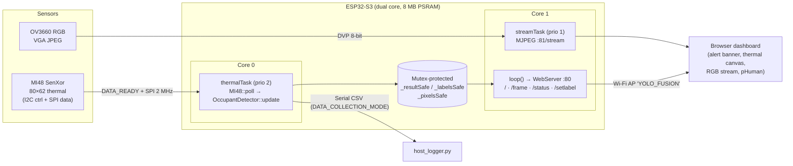
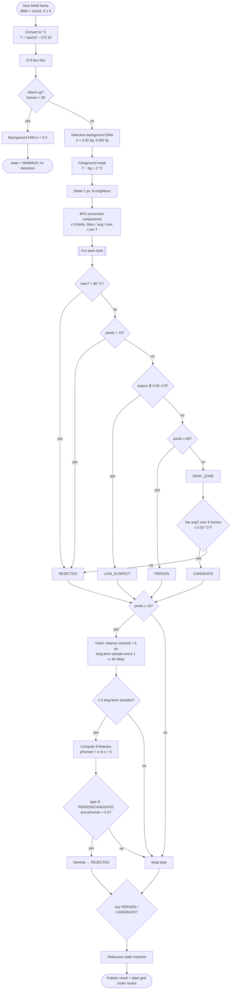
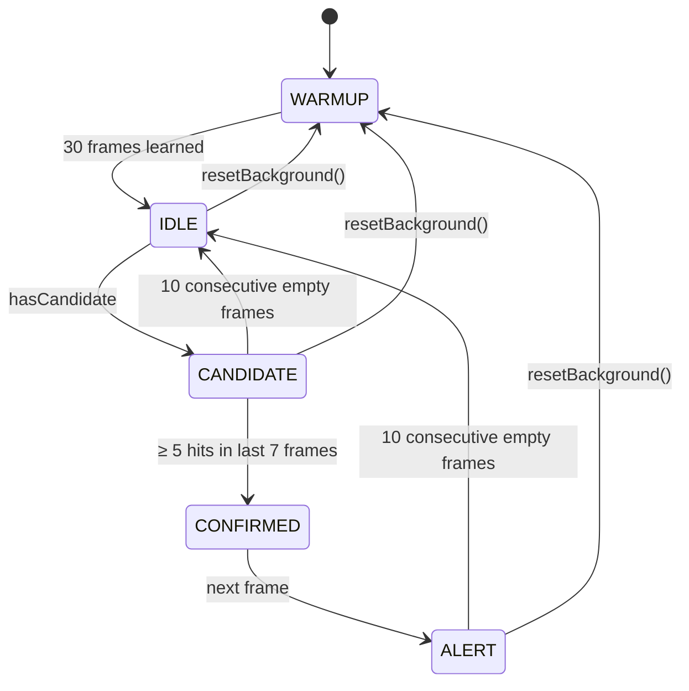
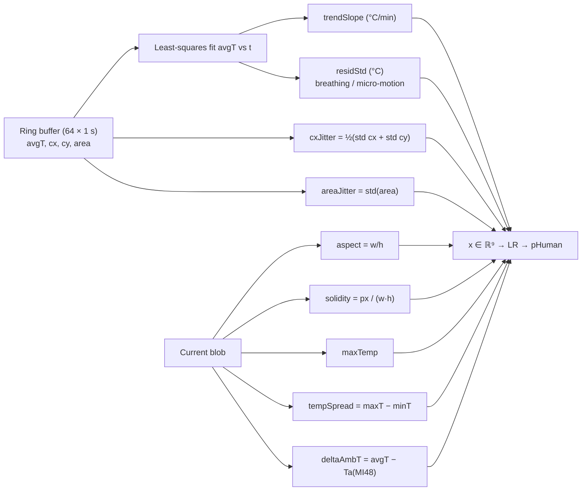
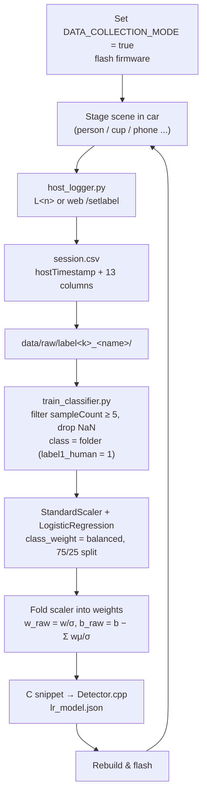

# System Flowcharts

These are Mermaid diagrams. They render on GitHub, in VS Code (Markdown Preview Mermaid), or at https://mermaid.live, where you can export them as SVG or PNG for the paper.

## 1. Hardware & software architecture

## 2. Per-frame detection pipeline (`OccupantDetector::update`)

## 3. Debounce state machine

## 4. Long-term feature extraction (per tracked blob)

## 5. Offline ML workflow (data → model → firmware)

